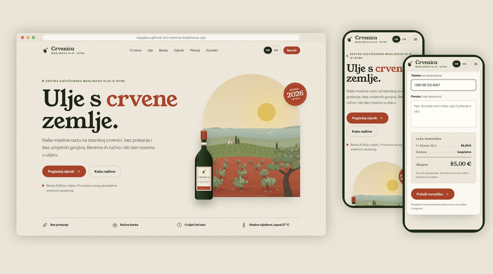
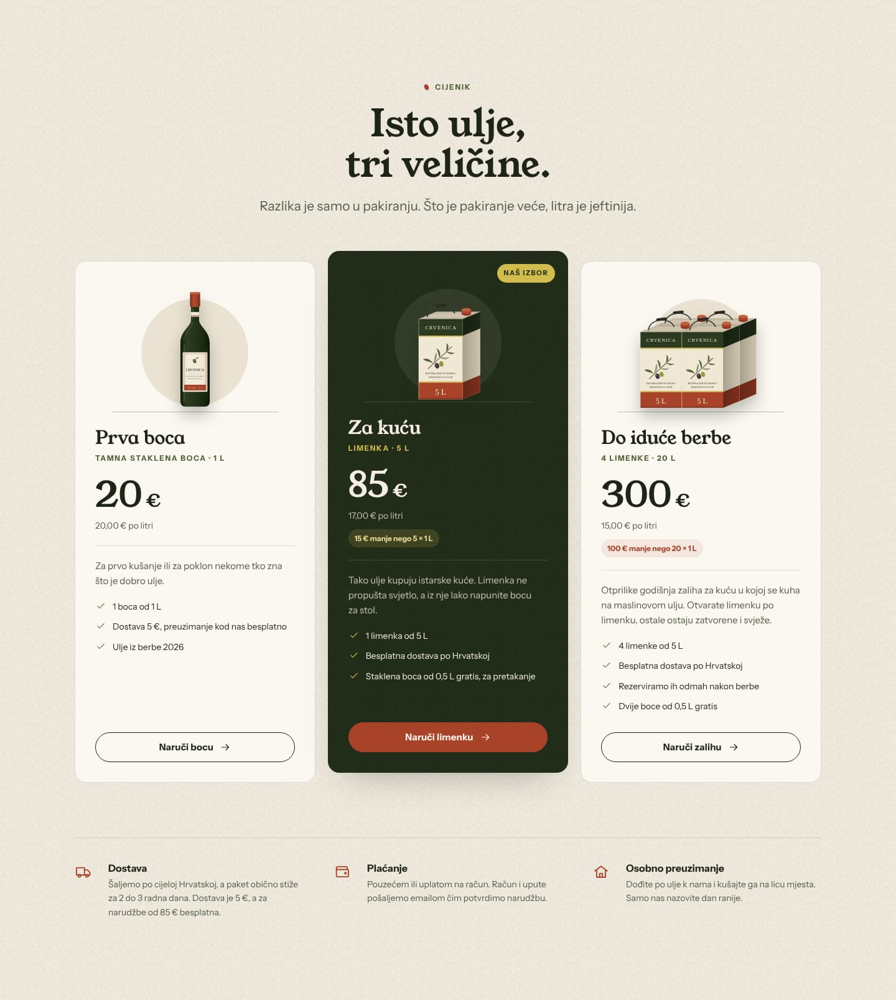
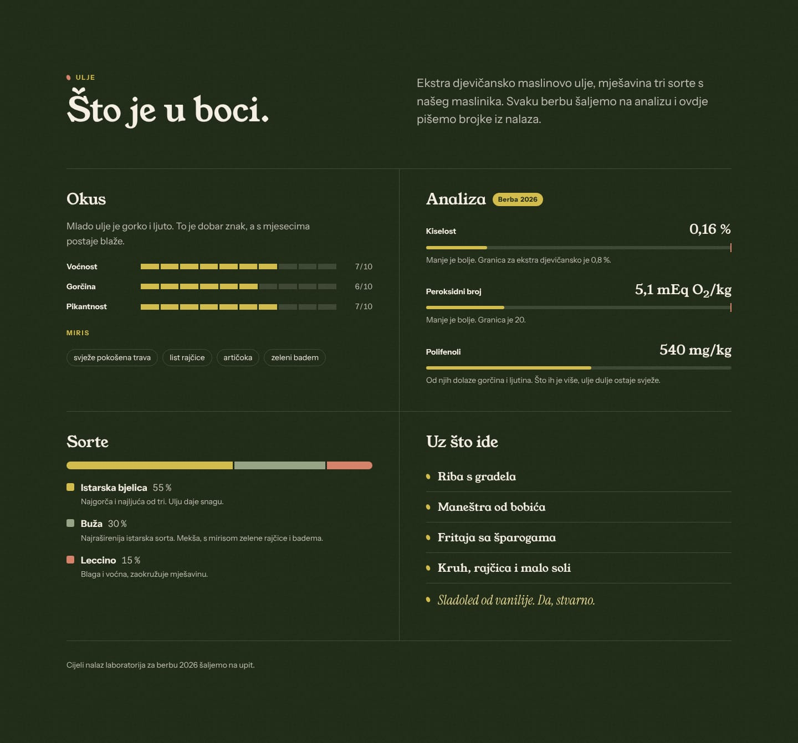
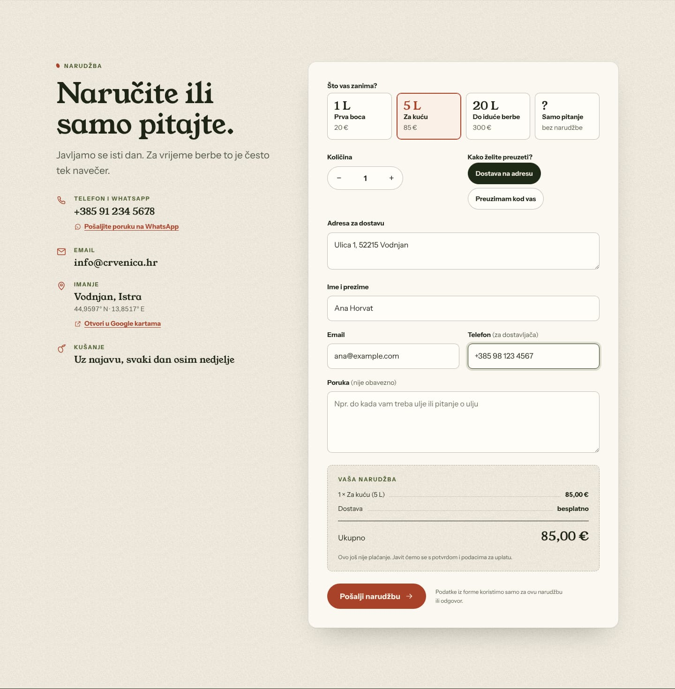

# Crvenica

**Brza dvojezična (hrvatski / engleski) stranica s jednom cjelinom za obiteljski maslinik u Istri**, s formom za narudžbu koja zbraja račun dok kupac tipka, automatskim izračunom cijene po litri i uštede, kalendarom berbe i laboratorijskim nalazom prikazanim trakama.

[**Pogledaj uživo**](https://mpajkov.github.io/crvenica-maslinovo-ulje/) · [English description](README.md) · Izradio [mpajkov](https://github.com/mpajkov)



> **Konceptni projekt.** Brend, obitelj, kontakt podaci, OPG/OIB i laboratorijske vrijednosti izmišljeni su, pa je stranica potpuni primjer kako može izgledati stranica malog proizvođača. Bez frameworka, bez instalacije, bez praćenja i bez kolačića: čisti HTML, CSS i JavaScript koji vlasnik može mijenjati u bilo kojem uređivaču teksta, a može se besplatno postaviti gotovo bilo gdje.

---

## Što dobiva posjetitelj

- **Jednu mirnu stranicu** koja objašnjava ulje onako kako bi to rekao sam proizvođač: tko ga radi, kakvog je okusa, što piše u laboratorijskom nalazu, kako izgleda godina u masliniku, koliko košta i kako do njega doći.
- **Hrvatski ili engleski jednim klikom.** Izbor se pamti, a linkovi oblika `?lang=en` rade za dijeljenje kupcima iz inozemstva.
- **Jasne cijene.** Tri paketa s cijenom po litri, uštedom u odnosu na male boce i pravilom o dostavi, sve izračunato automatski.
- **Formu koja izgleda kao račun.** Kupac odabere paket (ili samo postavi pitanje), količinu, dostavu ili preuzimanje i odmah vidi ukupan iznos, uključujući besplatnu dostavu iznad zadanog iznosa.
- Stranicu koja je **ugodna na svakom ekranu**: mobitel, tablet, laptop i veliki monitori.



## Što dobiva vlasnik

- **Jedan blok s postavkama** (`script.js`, PART 1) za email, telefon, WhatsApp broj, ključ za formu, godinu berbe, cijenu dostave, iznos od kojeg je dostava besplatna, koordinate imanja i adresu stranice. Svaka vrijednost sama se upiše na sva mjesta na stranici na kojima se prikazuje.
- **Cijene na jednom mjestu.** Paket se određuje s `data-price` i `data-liters` na njegovoj kartici. Cijena po litri, ušteda, tekst o dostavi, izbori u formi, sažetak narudžbe i podaci za Google izračunavaju se iz ta dva broja.
- Narudžbe stižu **emailom**, uvijek na hrvatskom za vlasnika, uz napomenu ako je kupac pisao na engleskom, a "Odgovori" ide izravno kupcu. Besplatno za otprilike 250 poruka mjesečno preko [Web3Forms](https://web3forms.com). Dok ključ nije upisan, otvara se kupčev email program s pripremljenom porukom pa nijedna narudžba ne propadne.
- **Zaštita od spama bez CAPTCHA-e** (skriveno polje, provjera vremena i kratka stanka), pa kupci nikad ne moraju klikati semafore.
- **Oprezni tekstovi o proizvodu** koji izbjegavaju tvrdnje koje mali proizvođač ne smije koristiti bez certifikata (vidi "Prije objave").
- **Bez troškova održavanja**: statične datoteke na GitHub Pages, Netlifyju, Cloudflare Pagesu ili običnom hostingu.

| Laboratorijski nalaz, okus i sorte | Forma za narudžbu |
|---|---|
|  |  |

---

## Provjere kvalitete

Sve navedeno izmjereno je na ovom kodu automatiziranim testovima (Playwright/Chromium). Sam Lighthouse nije se mogao instalirati u okruženju u kojem je stranica građena.

| Područje | Rezultat |
|---|---|
| **Brzina** (simulirani srednji mobitel: procesor 4 puta sporiji, 1,6 Mbit/s, kašnjenje 150 ms) | Prvi prikaz oko 1,2 s, glavni sadržaj (LCP) oko 1,4 s, pomak rasporeda 0,005 · na računalu: 0,4 s / 0,5 s |
| **Veličina** | 179 KB u 11 zahtjeva (HTML 19, CSS 16, JS 15, slike 43, fontovi 86 KB) |
| **Prilagodba ekranima** | Nema vodoravnog pomicanja ni sadržaja izvan ekrana pri 320, 375, 414, 768, 1024, 1440 i 1920 px, na oba jezika; izgled pregledan na mobitelu, tabletu i računalu |
| **Pristupačnost** | Poveznica "preskoči na sadržaj", vidljiv fokus, izbornik i forma u potpunosti rade tipkovnicom (Esc zatvara izbornik na mobitelu, fokus se pametno premješta), oznake za čitače ekrana, greške povezane s poljima, ukupni iznos narudžbe se objavljuje čitačima, kontrast teksta 4,5:1 ili bolji (izmjeren i na teksturiranoj pozadini), površine za dodir najmanje 24 px, podrška za smanjeno kretanje |
| **Sigurnost** | Stroga Content-Security-Policy (skripte, stilovi, fontovi i slike samo s same stranice, forme smiju slati samo na Web3Forms, bez `eval`), bez vanjskih skripti i fontova, bez `innerHTML` u skripti, prijevodi se čitaju kroz popis dopuštenih oznaka, čišćenje unosa, dodatna zaglavlja u datoteci `_headers` |
| **Privatnost** | Bez analitike, bez kolačića i bez Google Fontsa. U pregledniku se pamti samo izbor jezika |
| **Ponašanje** | 155 automatskih provjera prolazi: promjena jezika, izbornik, računanje cijena i sažetka, provjera polja, slanje s uspjehom, greškom poslužitelja i greškom mreže, zaštita od spama, pitanja i odgovori, kalendar berbe, strukturirani podaci, provedba CSP-a, 404 stranica |
| **Greške** | Nema grešaka u konzoli ni kršenja CSP-a na nijednoj širini ekrana ni jeziku |

---

## Struktura projekta

```
index.html                 cijela stranica (hrvatski tekst + engleski prijevod u data-en)
style.css                  sav izgled, podijeljen u PART 1-16 (sadržaj je na vrhu datoteke)
script.js                  sve ponašanje, PART 1-13 (PART 1 = SETTINGS, dio koji mijenjaš)
404.html                   prijateljska stranica "nije pronađeno" (također prevedena)
assets/
  fonts/                   Young Serif, Instrument Sans, Instrument Serif (WOFF2, lokalno) + licence
  img/                     ilustracije: krajolik, boca 1 L, limenka 5 L, četiri limenke, maslinova grana (SVG)
  favicon.svg, apple-touch-icon.png, og-image.jpg
docs/screenshots/          slike korištene u ovom opisu
tools/make-grain.mjs       neobavezna skripta koja stvara teksturu papira (stranica ne treba nikakav build)
_headers                   sigurnosna zaglavlja i keširanje za Netlify / Cloudflare Pages
sitemap.xml, robots.txt    datoteke za tražilice
```

Otvori `index.html` dvoklikom: sve radi i bez interneta, osim slanja forme.

## Svakodnevne izmjene

**Postavke.** Otvori `script.js` i promijeni vrijednosti u `SETTINGS` (PART 1). Uz svaki redak je komentar, a oznaka `PROMIJENI` u `index.html` pokazuje svaki tekst koji je samo primjer.

**Cijene i paketi.** Promijeni `data-price` i `data-liters` na kartici paketa u `index.html`:

```html
<article class="package" data-package="5l" data-price="85" data-liters="5">
```

Za novi paket kopiraj cijeli `<article class="package">` i promijeni podatke i tekstove.

**Primanje narudžbi emailom.** Napravi besplatan ključ na [web3forms.com](https://web3forms.com) (upišeš email vlasnika, ključ stigne na mail) i zalijepi ga u `web3formsKey`. Ključ je zamišljen kao javan.

**Tekstovi i prijevod.** Hrvatski se piše normalno u HTML-u, a engleska verzija je u atributu `data-en` na istom elementu:

```html
<p data-en="Hello">Bok</p>
```

Za tekst koji sadrži oznake poput `<em>` ili `<sub>` koristi `data-en-html`, a za atribute `data-en-alt`, `data-en-placeholder`, `data-en-aria-label` i `data-en-content`. Tekstovi koje piše JavaScript (poruke u formi, "po litri") nalaze se u `TEXTS` (PART 2 u `script.js`). Ako prijevod nedostaje, tekst ostane na hrvatskom.

**Laboratorijske vrijednosti.** Kiselost, peroksidni broj, polifenoli, ocjene okusa i udjeli sorti su primjeri. Upiši brojke iz svog nalaza, trake se same nacrtaju iz `style="--value: ..."`.

**Boje i fontovi.** Sve su varijable u `style.css`, PART 2.

**Nova sekcija.** Kopiraj predložak na dnu `<main>` (traži `PREDLOŽAK ZA NOVU SEKCIJU`), dodaj link u izbornik, novi PART u stilove prije PART 16 i, samo ako treba ponašanje, funkciju u `script.js`.

## Objava

Najjednostavnije je GitHub Pages: *Settings, Pages, Deploy from a branch, `main` / root*. Radi i povlačenje mape na [app.netlify.com/drop](https://app.netlify.com/drop), kao i svaki drugi hosting: prenesi sve datoteke i sačuvaj strukturu mapa.

Kad stranica dobije vlastitu domenu, zamijeni `https://mpajkov.github.io/crvenica-maslinovo-ulje/` u `index.html` (canonical, `og:url`, `og:image`), `404.html`, `sitemap.xml`, `robots.txt` i `siteUrl` u `script.js` (pretraga tog teksta pronađe sva mjesta).

**Ova javna kopija je demo**, pa nosi `<meta name="robots" content="noindex">` i napomenu o demu u podnožju. Za pravu objavu obriši oboje (označeni su u HTML-u), pa u podnožje upiši prave podatke imanja: OPG, OIB i MIBPG obavezni su kad se prodaje preko interneta.

**Zaglavlja.** GitHub Pages ne može postavljati HTTP zaglavlja, pa svaka stranica nosi svoju Content-Security-Policy kao `<meta>` oznaku. Na Netlifyju ili Cloudflare Pagesu priložena datoteka `_headers` dodatno uključuje zaštitu od ugrađivanja stranice (clickjacking), HSTS i pravila keširanja. `style-src-attr 'unsafe-inline'` postoji samo za male vrijednosti `style="--value: 7"` koje crtaju trake; sami stilski listovi smiju doći samo s same stranice.

## Prije objave (pravila EU-a za prodavače maslinovog ulja)

- **"Ekološko", "bio"** smije pisati samo uz certifikat (EU uredba 2018/848). Stranica zato piše "bez prskanja", a u pitanjima objašnjava da certifikata nema.
- **"Hladno cijeđeno"** smije pisati samo ako je ulje dobiveno ispod 27 °C (EU uredba 29/2012). Ako to za vaše ulje nije točno, makni.
- **Zdravstvene tvrdnje** o polifenolima trebaju nalaz koji ih dokazuje (EU uredba 432/2012), pa ih stranica nema.
- Tvrdnja "10 puta najbolja maslinarska regija" odnosi se na Istru kao regiju (vodič Flos Olei) i ima poveznicu na izvor. Broj ažuriraj kad izađe novo izdanje.

---

## Zasluge i prava

- Fontovi: Young Serif, Instrument Sans i Instrument Serif, SIL Open Font License 1.1, priloženi u `assets/fonts` zajedno s licencama.
- Ilustracije su izrađene za ovaj projekt.
- Brend "Crvenica", obitelj, kontakt podaci i sve brojke su izmišljeni.
- Izvorni kod: &copy; 2026 mpajkov, sva prava pridržana. Objavljen je da potencijalni klijenti mogu procijeniti kvalitetu rada; za ponovno korištenje molim prvo upit.

Želiš li ovakvu stranicu za svoje imanje, trgovinu ili posao? Javi se preko [github.com/mpajkov](https://github.com/mpajkov).
